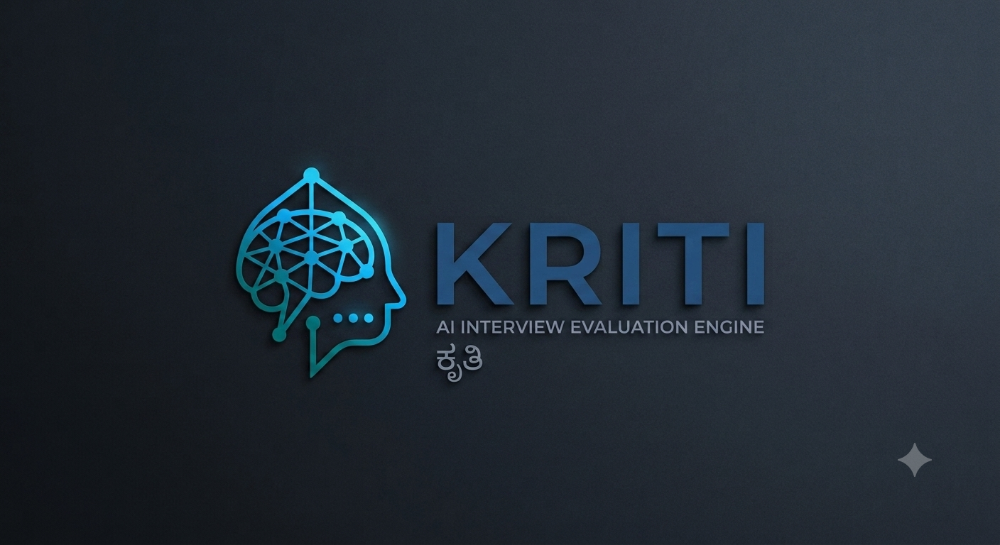
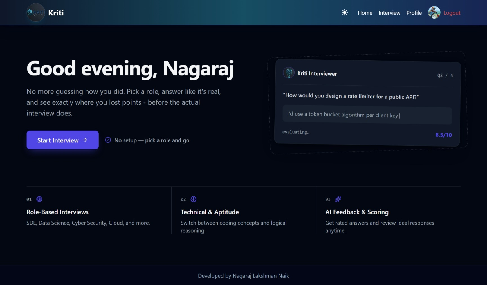
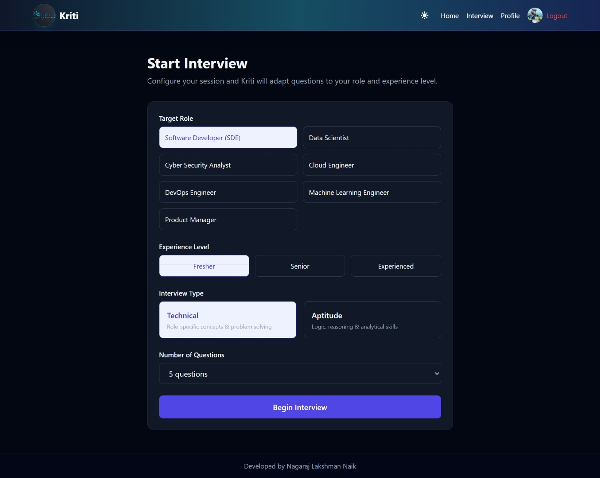
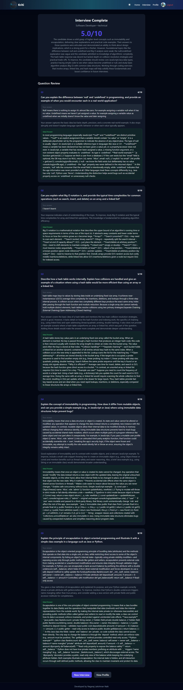
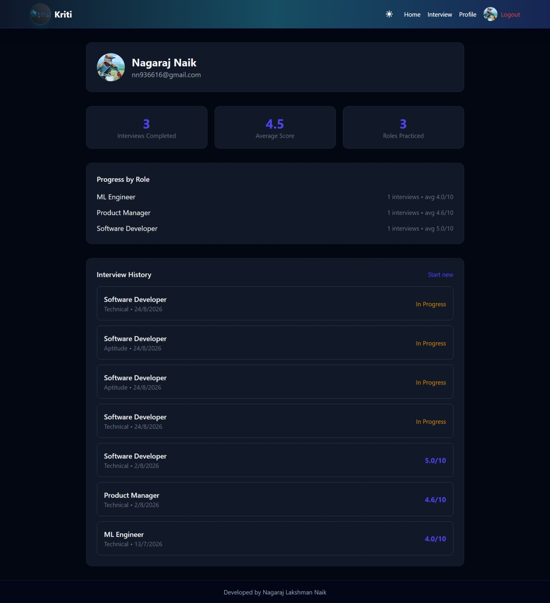

<div align="center">
  
  <h1>KRITI – AI Interview Preparation Platform</h1>
  <p><strong>Practice role-based technical and aptitude interviews with real-time AI feedback.</strong></p>

  <p>
    <a href="https://kriti-egzt.onrender.com"><strong>🚀 Live Demo</strong></a> •
    <a href="#-features">Features</a> •
    <a href="#-tech-stack">Tech Stack</a> •
    <a href="#-pwa--installability">App Installation</a> •
    <a href="#-installation">Local Setup</a>
  </p>
</div>

---

## 📌 Overview

> 🌐 **Live Demo:** [**https://kriti-egzt.onrender.com**](https://kriti-egzt.onrender.com)  
> *Experience the platform live — practice role-tailored technical and aptitude mock interviews with real-time AI evaluation.*

**Kriti** is an intelligent, full-stack mock interview platform built on the **MERN stack** and powered by **Groq AI**. It offers candidates an authentic, low-pressure simulation environment to hone their technical problem-solving, behavioral communication, and aptitude skills.

### Key Highlights
- **Live Deployment**: Try the application instantly at [**kriti-egzt.onrender.com**](https://kriti-egzt.onrender.com).
- **Seamless One-Click Login**: Fast Google OAuth authentication via Passport.js.
- **Custom Role Mock Interviews**: Tailored sessions for Software Engineers, Data Scientists, Cloud Architects, and more.
- **Dynamic Question Generation**: Context-aware prompts generated on the fly based on selected role and seniority.
- **Automated AI Answer Grading**: Instant scoring, actionable critiques, and model answers for every question.
- **Installable Progressive Web App (PWA)**: Installable across Android, iOS, Windows, and macOS for a native app feel.

---

## 🚀 Features

- **Role-Based Paths**: Choose from multiple technical disciplines and experience levels (Junior, Mid, Senior).
- **Dual Assessment Modes**: Practice both coding/technical questions and logical/aptitude scenarios.
- **Adaptive Evaluation Engine**: AI scores responses on technical accuracy, clarity, and completeness.
- **Comprehensive Review Dashboard**: Detailed breakdown of every answer, including strengths, areas of improvement, and ideal answers.
- **Performance History**: Saved session archives to measure and visualize improvement over time.
- **Dark-Themed, Responsive UI**: Tailored for focused interview practice across all screen sizes.

---

## 🖼 Screenshots

| Home | Interview Session |
| :---: | :---: |
|  |  |

| Feedback & Review | Profile & History |
| :---: | :---: |
|  |  |

---

## 📱 PWA & Installability

Kriti includes a standard Web App Manifest and adaptive maskable icon suite:
- **Desktop (Chrome/Edge)**: Click the **Install** button in the browser address bar to install Kriti as a standalone desktop application.
- **Android**: Tap the in-browser banner or **"Add to Home Screen"** to run Kriti with full-screen, native app behavior.
- **iOS (Safari)**: Tap the **Share** button and select **"Add to Home Screen"** to pin the high-resolution app icon.

---

## 🛠 Tech Stack

### Frontend
- **Framework**: React 18 (Vite)
- **Styling**: Tailwind CSS, PostCSS, Lucide Icons
- **Routing & State**: React Router DOM v6, Context API
- **Notifications**: React Hot Toast
- **Networking**: Axios
- **PWA Assets**: Adaptive maskable icons (192px, 512px), multi-resolution `favicon.ico`, and `site.webmanifest`

### Backend
- **Runtime**: Node.js & Express.js
- **Database**: MongoDB with Mongoose
- **Authentication**: Passport.js (Google OAuth 2.0), JWT
- **AI Engine**: Groq SDK (`groq-sdk`)

---

## 📂 Project Structure

```text
KRITI/
├── backend/
│   ├── src/
│   │   ├── config/          # Database, Passport, & OAuth configs
│   │   ├── controllers/     # Authentication & interview controllers
│   │   ├── models/          # User & Interview schemas
│   │   ├── routes/          # RESTful API route definitions
│   │   ├── services/        # Groq AI prompt generation & evaluation
│   │   └── index.js         # Express server entry point
│   ├── package.json
│   └── .env
├── frontend/
│   ├── public/              # Static brand assets, PWA icons & manifest
│   │   ├── kritiLogo.png    # Master brand logo
│   │   ├── favicon.ico      # Multi-size tab icon (16, 32, 48)
│   │   ├── apple-touch-icon.png
│   │   ├── icon-192.png
│   │   ├── icon-512.png
│   │   ├── icon-maskable-512.png
│   │   └── site.webmanifest # Web App Manifest
│   ├── src/
│   │   ├── components/      # UI elements (Navbar, ThemeToggle, etc.)
│   │   ├── context/         # AuthContext & ThemeContext
│   │   ├── pages/           # Home, InterviewRoom, Review, Profile, Login
│   │   └── utils/           # API helpers
│   ├── index.html
│   └── package.json
├── generate-icons.cjs       # Icon generation script (sharp & to-ico)
└── README.md
```

---

## ⚙️ Prerequisites

- **Node.js**: v18.0.0 or higher
- **npm**: v10.0.0 or higher
- **MongoDB**: Local MongoDB instance or MongoDB Atlas URI
- **Groq API Key**: Obtainable from [Groq Console](https://console.groq.com/)
- **Google OAuth Credentials**: From the [Google Cloud Console](https://console.cloud.google.com/)

---

## 🔑 Environment Variables

Create a `.env` file in the `backend/` directory:

```env
PORT=5000
NODE_ENV=development
MONGODB_URI=mongodb://127.0.0.1:27017/kriti
JWT_SECRET=your_super_secret_jwt_key
CLIENT_URL=http://localhost:5173

# Google OAuth
GOOGLE_CLIENT_ID=your_google_client_id
GOOGLE_CLIENT_SECRET=your_google_client_secret
GOOGLE_CALLBACK_URL=http://localhost:5000/api/auth/google/callback

# Groq AI Configuration
GROQ_API_KEY=your_groq_api_key
GROQ_MODEL=openai/gpt-oss-120b
```

---

## 🖥 Local Setup & Installation

1. **Clone the repository**:
   ```bash
   git clone <your-repo-url>
   cd KRITI
   ```

2. **Install backend dependencies**:
   ```bash
   cd backend
   npm install
   ```

3. **Install frontend dependencies**:
   ```bash
   cd ../frontend
   npm install
   ```

---

## ▶️ Running the Application

### 1. Start the Backend API
```bash
cd backend
npm run dev
```
*Backend runs on `http://localhost:5000`.*

### 2. Start the Frontend
```bash
cd frontend
npm run dev
```
*Frontend dev server runs on `http://localhost:5173`.*

### 3. Production Build
```bash
cd frontend
npm run build
```
*The compiled assets will be placed into `frontend/dist/`.*

---

## 🌐 Deployment

Kriti is configured for production hosting on **Render**:
- **Static & API Serving**: Express serves the compiled `frontend/dist` directory in production.
- **Database**: Cloud persistence through MongoDB Atlas.
- **Live URL**: [https://kriti-egzt.onrender.com](https://kriti-egzt.onrender.com)

---

## 🔗 Key API Endpoints

| Method | Endpoint | Description |
| :--- | :--- | :--- |
| `GET` | `/api/health` | Health check route |
| `GET` | `/api/auth/google` | Initiates Google OAuth login |
| `GET` | `/api/auth/google/callback` | OAuth callback & JWT issuance |
| `GET` | `/api/auth/me` | Fetch authenticated user profile |
| `POST` | `/api/interviews/start` | Initialize a new role-based mock interview |
| `POST` | `/api/interviews/:id/answer` | Submit answer and receive AI evaluation |
| `GET` | `/api/interviews/:id/review` | Retrieve full interview analysis and scoring |
| `GET` | `/api/interviews/history` | Retrieve user's previous interview sessions |

---

## 🧑‍💻 Author

**Nagaraj Lakshman Naik**  
*Passionate about building scalable AI-integrated systems, full-stack applications, and clean software architectures.*